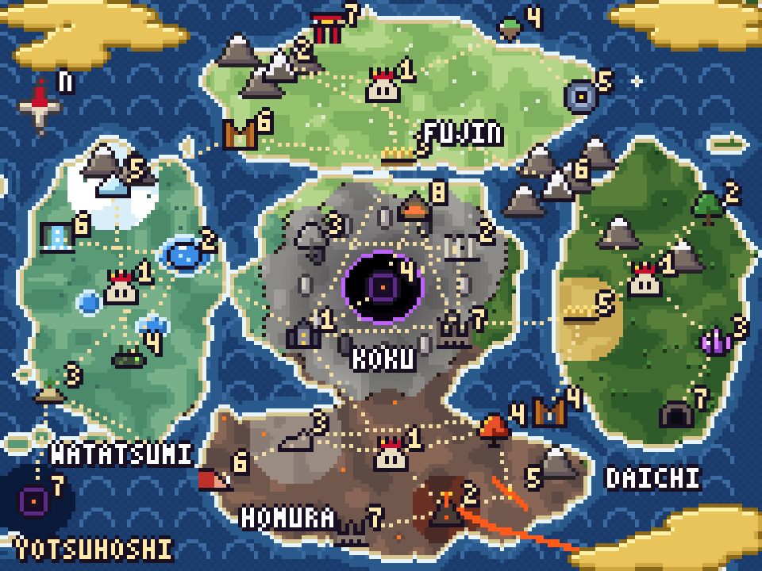

# 四星 YOTSUHOSHI — *O Eclipse do Ovo Eterno*
### RPG de Anime no WhatsApp



> *Há 500 anos, um garoto roubou o ovo de um dragão. O mundo queimou, um buraco negro se abriu e quatro reis
> deram a vida para selar o mal. Agora alguém quer abrir o caixão — e o ovo, perdido, escolheu um de vocês.*

RPG narrativo jogado em **grupos de WhatsApp**, com mundo temático estilo anime, narração e
continuidade de história gerida por IA (até o **final que o autor definir**), fichas e cartas
de personagem/vilão geradas como imagem, combate por turnos, itens lendários e 100 vilões.

Este repositório contém o **planejamento completo (Game Design Document)**, os **dados estruturados** do mundo
e o **roteiro executável** da história (`data/historia.yaml`: 4 atos, 53 marcos, 3 finais). O objetivo dos
jogadores é ficar fortes o bastante para derrotar o Eclipse e ser coroado **Seiō (星王), o Rei-Estrela**.
Dificuldade: **difícil** — vilões podem vencer, a morte pode ser permanente, e estratégia e criatividade contam.

**Jogável agora:** criação de personagem, carta, prólogo e exploração individual no privado:
`explorar`, `mapa`, `rota`, `viajar`, `viagem`, `vigor`, `descobertas`, `inventario` e escolhas de evento.
Viagens e vigor persistem sem cron; a chegada é reconhecida no próximo comando após o prazo.
Encontros ficam disponíveis para recuo, mas o combate e a entrada nas masmorras ainda são etapas futuras.
Veja [comandos, regras implementadas e limites da primeira etapa](docs/32-exploracao-implementada.md).

---

## Índice do planejamento

| # | Documento | Conteúdo |
|---|-----------|----------|
| 01 | [Arquitetura técnica](docs/01-arquitetura-tecnica.md) | Bot de WhatsApp, banco, IA, imagens, segurança anti-trapaça |
| 02 | [O mundo e os 4 reinos](docs/02-mundo-e-reinos.md) | Continente, reinos (nomes em japonês), reis, natureza, mapa detalhado |
| 03 | [Sistema de mana](docs/03-sistema-de-mana.md) | Como a mana funciona: corpo, ambiente, elementos, castas, classes |
| 04 | [Entrada no mundo e sorteio](docs/04-entrada-e-sorteio.md) | "entrar no mundo", aldeias, castas, atributo mágico, pet espiritual |
| 05 | [Classes](docs/05-classes.md) | Mago, Cavaleiro, Bruxo, Anti-magia, Espadachim, Meio-humano, Força da Natureza, Demônio, Paladino |
| 06 | [Itens lendários e grimórios](docs/06-itens-lendarios.md) | Os 4 Grandes Itens, o Amuleto da Perdição, 40 grimórios simples |
| 06b | [Lista dos 40 grimórios](docs/06b-grimorios.md) | Gerado de `data/grimorios.json` |
| 07 | [Subfases e masmorras](docs/07-subfases.md) | 36 subfases com nível, chefes e drops (gerado) |
| 08 | [Progressão e combate](docs/08-progressao-e-combate.md) | Atributos, XP, níveis, ranks, mérito, fórmulas de batalha |
| 09 | [Os 100 vilões](docs/09-viloes.md) | Gerado de `data/viloes.json` (comum → divindade) |
| 10 | [Templates de imagem](docs/10-templates-de-imagem.md) | Cartas de personagem e vilão |
| 11 | [Motor narrativo de IA](docs/11-motor-narrativo-ia.md) | Como a IA continua a história e chega ao final definido |
| 12 | [Roteiro: status e como editar](docs/12-roteiro-da-historia.md) | Como mexer no `data/historia.yaml` |
| 13 | [Comandos do jogador](docs/13-comandos.md) | Tudo que o jogador pode digitar no grupo e no privado |
| 14 | [**A história principal**](docs/14-historia-principal.md) | O roubo do ovo, Kaien, Nisteroy, o Esquife, o Ovo Eterno, Kanata, o Seiō, finais |
| 15 | [Arcos dos reinos](docs/15-arcos-dos-reinos.md) | Histórias complementares de cada reino e das 24 aldeias |
| 16 | [Vilão principal e manipulação](docs/16-vilao-principal-e-manipulacao.md) | Kanata/Yoru, sussurros, pactos, Corrupção, traição entre jogadores |
| 17 | [Sub-vilões](docs/17-sub-viloes.md) | Arautos do Eclipse, Ressurgidos e servos |
| 18 | [Bestiário](docs/18-animais.md) | 36 animais (gerado de `data/animais.json`) |
| 19 | [Dificuldade, derrota e estratégia](docs/19-dificuldade-derrota-estrategia.md) | Morte, Batalhas Mortais, Juiz de Táticas, Relógio do Eclipse |
| 20 | [**Direção de arte**](docs/20-direcao-de-arte.md) | Pesquisa de referências, paletas, formas por reino, galerias |
| 21 | [**Criador de avatares e mapas**](docs/21-criador-de-avatares-e-mapas.md) | Pixel art procedural: DNA, catálogo, avatar do jogador, mapas |
| 22 | [**Jogabilidade completa**](docs/22-jogabilidade.md) | Fluidez no WhatsApp, grupo × privado, combate em rodada simultânea, Postura, reações elementais, subida de atributos, todos os modos e situações |
| 22b | [Balanceamento](docs/22b-balanceamento.md) | Gerado pelo simulador: jogador × vilão por nível, curva de XP, ritmo da campanha |
| 23 | [**Pets espirituais**](docs/23-pets-espirituais.md) | 20 pets × 3 estágios em pixel art, vínculo e evolução |
| 24 | [**Comandos e fala natural**](docs/24-comandos-e-linguagem-natural.md) | Como o bot entende o jogador (implementado em `src/linguagem/`, 91 testes) + referência de comandos |
| 25 | [**Combate individual**](docs/25-combate-individual.md) | Abordagem, distância, Fluxo, Defesa Perfeita, Momento Decisivo, exemplo com números reais |
| 26 | [**Contos, flashbacks e trajetória**](docs/26-contos-flashbacks-e-trajetoria.md) | 20 contos, 10 ecos do passado jogáveis, 12 Chaves de Conhecimento, 12 marcas de trajetória |
| 27 | [**Encruzilhadas**](docs/27-encruzilhadas.md) | 12 decisões que mudam a história, efeito borboleta, epílogos |
| 28 | [**Conflito entre jogadores**](docs/28-conflito-entre-jogadores.md) | Rivalidade, disputa, julgamento, facções, furto, terras sem lei, paz |
| 29 | [**Travas, técnicas e casos especiais**](docs/29-travas-tecnicas-e-casos-especiais.md) | Anti-buff, ver o card de outros jogadores, luta real com Veredito, interferência do destino, teletransporte, interações de habilidades |
| 30 | [**Infraestrutura WhatsApp**](docs/30-infraestrutura-whatsapp.md) | Evolution API (multi-instância), Vercel, Neon, relógio no VPS, IA Sabiá ou Claude, variáveis, implantação |
| 31 | [**Passo a passo da implantação**](docs/31-passo-a-passo-implantacao.md) | Checklist: chaves, Vercel, Neon, Evolution sem afetar o outro bot, relógio, deploy, primeiro teste |
| 32 | [**Exploração implementada**](docs/32-exploracao-implementada.md) | Comandos, vigor, viagens persistentes, sorteio, testes e limites da primeira etapa |
| 33 | [**Narrador e combate**](docs/33-narrador-e-combate-implementados.md) | O que já funciona: textos de origem/região, ação livre com IA, combate solo, XP e níveis |
| 34 | [**Mundo vivo, combate com dado e auditoria**](docs/34-mundo-vivo-combate-e-auditoria.md) | Locais com imagens, NPCs, capítulos, vilões em covis (derrota única), itens, feitos no grupo, pets, duelo, pactos, o que falta |

## Dados estruturados (`data/`)

| Arquivo | Conteúdo |
|---------|----------|
| `data/reinos.json` | 4 reinos + Terra Central, reis, regiões |
| `data/aldeias.json` | 24 aldeias (6 por reino) com casta e peso de sorteio |
| `data/atributos-magicos.json` | Atributos mágicos sorteáveis e raridades |
| `data/classes.json` | 9 classes, atributos base, restrições |
| `data/pets.json` | Pets espirituais |
| `data/itens-lendarios.json` | 4 Grandes Itens + Amuleto da Perdição |
| `data/grimorios.json` | 40 grimórios simples |
| `data/subfases.json` | 36 subfases |
| `data/viloes.json` | 100 vilões com atributos, ficha visual e caminho do avatar |
| `data/aparencias.json` | Bíblia visual: paletas, formas, escala por tier, fichas completas dos personagens |
| `data/animais.json` | 36 animais (fauna, montarias, criaturas mágicas) |
| `data/historia.yaml` | Roteiro executável: atos, marcos, fatos, proibições, finais, encruzilhadas, epílogos |
| `db/migrations/` | Esquema do banco (Postgres/Neon), testado |
| `src/ia/` | Camada de IA: Sabiá (Maritaca) ou Claude, narrador com validação |
| `api/`, `src/servidor/` | Servidor do bot na Vercel: webhook da Evolution, sorteio, criação de personagem, carta em PNG, tick |
| `relogio/` | Serviço de prazos para o VPS (Docker) |
| `deploy/` | Docker Compose para rodar no VPS: Postgres + backups + relógio (+ jogo na próxima etapa) |
| `data/contos.yaml` | Contos, flashbacks, Chaves de Conhecimento, desafios, marcas de trajetória |

## Templates (`templates/`)

- `templates/carta-personagem.html` — carta do jogador (renderizada para PNG e enviada no grupo)
- `templates/carta-vilao.html` — carta de vilão com tier, atributos e habilidade
- `scripts/render-cartas.mjs` — renderiza as cartas de exemplo com Playwright
- `scripts/viloes-fonte.mjs` — fonte editável dos 100 vilões (nome, tier, nível, arquétipo, habilidade…)
- `scripts/gerar-dados.mjs` — calcula atributos dos vilões, valida referências cruzadas e gera
  `data/viloes.json`, `docs/09-viloes.md`, `docs/06b-grimorios.md` e `docs/07-subfases.md`

```bash
node scripts/gerar-dados.mjs        # regenera dados/docs e valida tudo
node scripts/render-avatares.mjs    # avatares em pixel art (vilões, NPCs, exemplos) + galerias
node scripts/render-mapas.mjs       # mapas em pixel art
node scripts/render-pets.mjs        # 20 pets × 3 estágios
node scripts/simular-progressao.mjs # tabela de balanceamento (docs/22b)
python3 scripts/validar-historia.py # valida roteiro, encruzilhadas, contos e chaves
node scripts/testar-linguagem.mjs   # 91 testes do entendimento de fala natural
node scripts/testar-regras.mjs      # testes das regras (Olho Avaliador)
node scripts/testar-combate.mjs     # combate (menu, dado, habilidades) e itens
node scripts/testar-mundo.mjs       # consistência do mundo vivo (regiões, covis, capítulos, campanha)
node scripts/testar-exploracao.mjs  # regras de exploração, vigor, rotas e mapas
bash db/testar-migracoes.sh         # aplica o esquema do banco num Postgres temporário e verifica
node scripts/testar-ia.mjs          # camada de IA (Sabiá/Claude) com respostas simuladas
node scripts/testar-relogio.mjs     # relógio de prazos
node scripts/testar-servidor.mjs    # criação + exploração/viagens num Postgres temporário, incluindo concorrência
npm run testar                      # todos os testes
node scripts/render-cartas.mjs      # gera exemplos de cartas em templates/exemplos/
```

## Números do mundo

| | |
|---|---|
| Reinos | 4 + Terra Central (虚空 Kokū) |
| Regiões | 36 (7 por reino + 8 centrais), cada uma com densidade de mana, perigo, recurso e segredo |
| Aldeias de origem | 24 (6 castas × 4 reinos) |
| Classes | 9 (+18 especializações no Rank B) |
| Atributos mágicos | 4 elementos × variantes + 12 raros/lendários |
| Pets espirituais | 20 (× 3 estágios em pixel art) |
| Itens lendários | 4 Grandes Itens + Amuleto da Perdição |
| Grimórios simples | 40 (ranks E → S) |
| Subfases | 36 |
| Vilões | 100 (35 comuns · 25 médio · 20 alto · 12 rei · 8 divindades), incluindo Kanata e o Rei do Eclipse |
| Animais | 36 |
| História | 4 atos · 53 marcos · 20 fatos · 7 camadas de verdade · 12 encruzilhadas · 3 finais |
| Conteúdo extra | 20 contos · 10 flashbacks jogáveis · 12 Chaves de Conhecimento · 12 marcas de trajetória |
