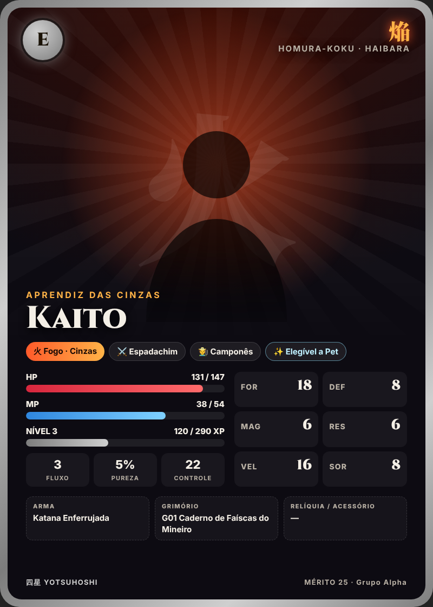
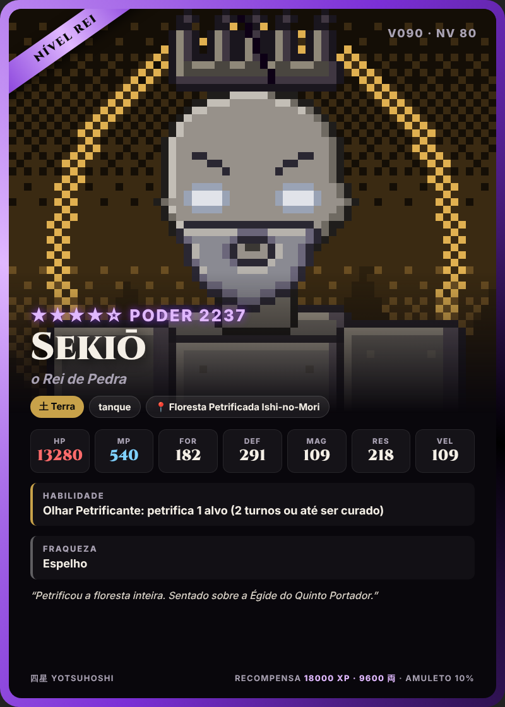

# 10 — Templates de Imagem

Duas camadas de imagem:

1. **Arte (retrato)** — gerada por IA de imagem **uma única vez** por personagem/vilão e guardada no storage.
2. **Carta** — template HTML fixo (`templates/*.html`) onde o motor injeta dados + retrato e tira um
   screenshot PNG de 800×1120 para enviar no WhatsApp.

Assim, a arte cara é gerada pouquíssimas vezes, e a carta (barata, instantânea) é regenerada sempre que
os atributos mudam (`!ficha`).

| Exemplo de carta de personagem | Exemplo de carta de vilão |
|:---:|:---:|
|  |  |

Exemplos de todos os tiers em `templates/exemplos/` (gerados com `node scripts/render-cartas.mjs`).
Sem retrato, o template usa um placeholder com o kanji do elemento (como nas imagens acima).

## 10.1 Carta de Personagem (`templates/carta-personagem.html`)

| Elemento visual | Fonte do dado |
|-----------------|---------------|
| **Moldura** (cor) | Rank: E ferro · D bronze · C prata · B ouro · A platina · S obsidiana · SS arco-íris |
| **Medalhão** (canto) | Letra do rank |
| **Kanji do reino** + aldeia | `reino`, `aldeia` |
| **Cor de fundo/aura** | Elemento do atributo mágico |
| **Retrato** | `retrato_url` (IA) ou placeholder |
| **Título + Nome** | Título vem de mérito/feitos (ex.: "Aprendiz das Cinzas", "Matador de Dragões") |
| **Tags** | Atributo mágico · classe · casta · pet/elegibilidade |
| **Barras** | HP, MP (ou Vazio para anti-magia), XP |
| **Mana** | Fluxo, Pureza, Controle |
| **Atributos** | FOR, DEF, MAG, RES, VEL, SOR |
| **Equipamento** | Arma, grimório, relíquia (borda brilhante se for item lendário) |
| **Rodapé** | Mérito e nome do mundo (grupo) |

## 10.2 Carta de Vilão (`templates/carta-vilao.html`)

Recebe diretamente um objeto de `data/viloes.json`.

| Tier | Cor da moldura | Estrelas |
|------|----------------|:---:|
| Comum | Cinza-prata | ★☆☆☆☆ |
| Médio escalão | Verde-jade | ★★☆☆☆ |
| Alto escalão | Azul-safira | ★★★☆☆ |
| Nível rei | Roxo-ametista | ★★★★☆ |
| Divindade | Ouro | ★★★★★ |

Mostra: faixa do tier, ID e nível, poder total, nome e título, elemento/arquétipo/região, HP/MP/FOR/DEF/MAG/RES/VEL,
habilidade, fraqueza, descrição e recompensa (XP, ouro, chance de Amuleto).

> **Máscara pública (anti-spoiler):** vilões ligados a segredos da história (Kanata, o Leiloeiro, Tōya, os reis
> antigos, Nisteroy, o Rei do Eclipse) têm um campo `mascara` em `data/viloes.json`. Até o marco `revela_em` ser
> concluído no mundo, a carta mostra o nome/título/descrição públicos e esconde habilidade e fraqueza
> (exemplos: `templates/exemplos/vilao-V091-mascara.png` e `vilao-V100-mascara.png`).

> Ao **encontrar** um vilão pela primeira vez, o jogador vê a carta com atributos ocultos (`???`) — só a
> magia *Ler o Inimigo* (G10), o pet Hakutaku ou derrotá-lo uma vez revelam os números. (Flag `oculto` no render.)

## 10.3 Prompts de arte (IA de imagem)

### Vilões
Cada vilão em `data/viloes.json` já tem `imagem.prompt` e `imagem.negative_prompt` prontos. Exemplo (V064):

```
anime style dark fantasy villain character portrait, lava dragon rising from a river of magma,
broken obsidian bridge, lava elemental aura, dramatic rim lighting, cel shading, highly detailed,
upper body, centered composition, dark atmospheric background, masterpiece
```

Gerar as 100 artes uma vez (script futuro `scripts/gerar-arte-viloes.mjs`) e salvar em `assets/viloes/V###.png`.

### Personagens (montado na criação)

```
anime style fantasy {classe_en} character portrait, {genero_opcional} young {raca}, {traço_da_casta},
wearing {roupa_do_reino}, {elemento_en} magic aura, {detalhe_classe}, cel shading, highly detailed,
upper body, centered, {fundo_da_aldeia}
```

| Variável | Exemplos |
|----------|----------|
| `traço_da_casta` | camponês: *simple patched clothes, determined eyes* · realeza: *ornate noble attire, jewelry* · cavaleiro: *light armor with order crest* · indefinido: *mysterious hooded cloak, mismatched eyes* · rei: *subtle crown motif, glowing royal sigil* |
| `roupa_do_reino` | Homura: *red and black samurai-inspired garments with ember patterns* · Watatsumi: *flowing blue robes with wave patterns and pearls* · Daichi: *earth-toned layered clothing with bronze and stone ornaments* · Fūjin: *light white and teal garments with feathers, scarf blowing in the wind* |
| `detalhe_classe` | Mago: *holding a glowing grimoire* · Anti-magia: *black chains, aura that dims nearby magic* · Espadachim: *katana at the hip* · Meio-humano: *{animal} ears and tail* · Demônio: *small horns, glowing red eyes* · Paladino: *holy shield with light runes* · Bruxo: *talismans and a pact mark on the hand* · Força da Natureza: *leaves and elements swirling around the body* · Cavaleiro: *heavy armor and greatsword* |

O jogador pode, na criação, descrever **aparência** (cabelo, olhos, gênero) em uma frase — isso entra no prompt,
mas é filtrado (nada que altere atributos, nada impróprio).

**Regenerar arte:** só no **Despertar** de rank (B, A, S, SS) — o retrato "evolui" junto com o personagem.

## 10.4 Outras imagens planejadas

| Imagem | Quando | Como |
|--------|--------|------|
| Mapa com posição | `!mapa` | SVG base do continente + marcador do jogador e da party |
| Carta de Item Lendário | Ao obter um dos 4 Grandes Itens | Template dourado especial com anúncio no grupo |
| Carta de Pet | `!pet` | Template menor, cor do elemento, estágio |
| Tela de Batalha | Início de batalha | Composição: cartas mini dos jogadores × vilões |
| Tela de Vitória / Level up | Fim de batalha | Banner com XP ganho, drops |
| Cerimônia do Sorteio | Entrada | 4 cartas-estrela reveladas em sequência |
