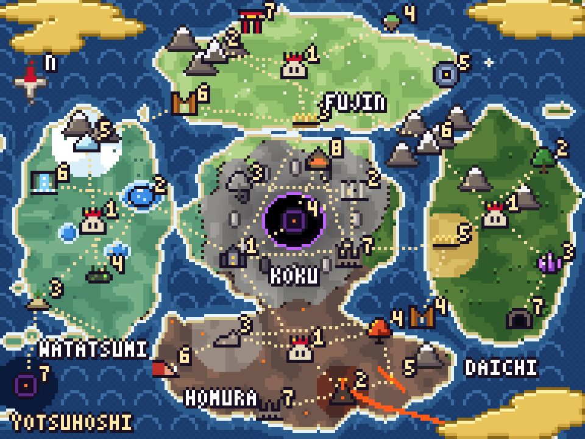
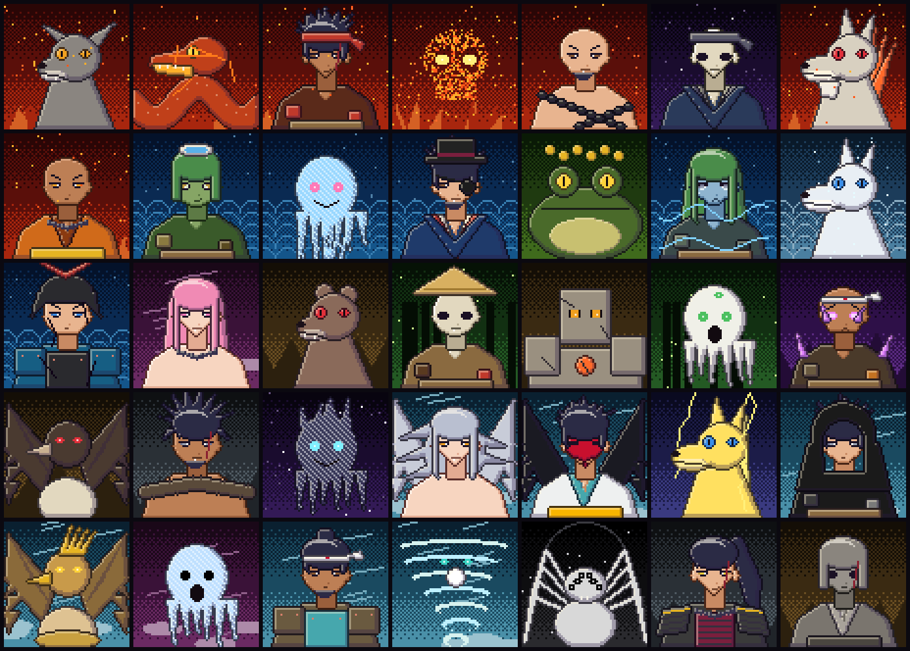
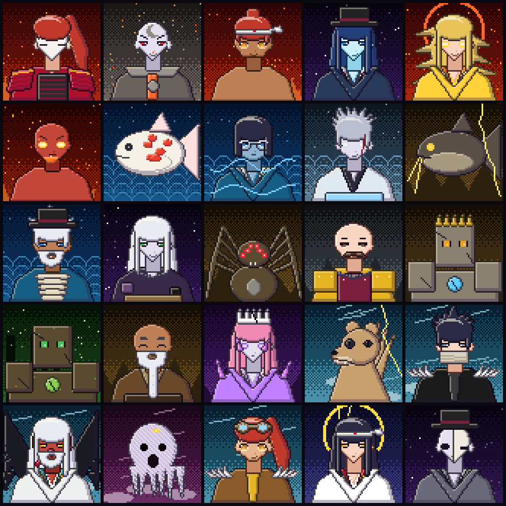
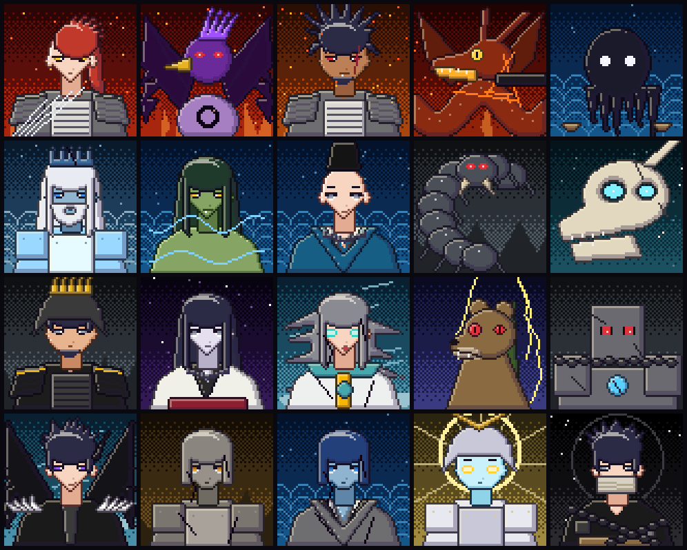
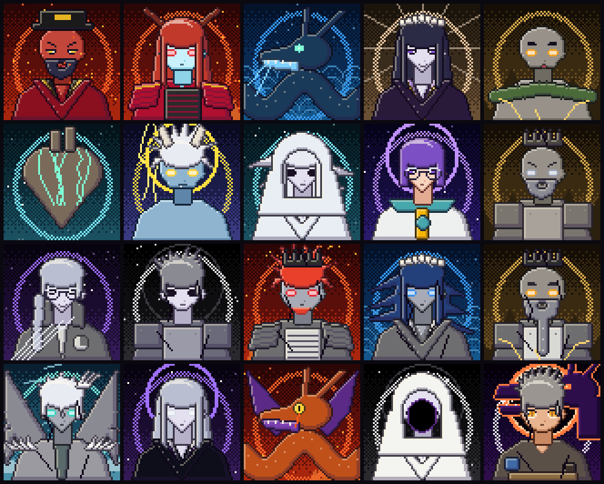
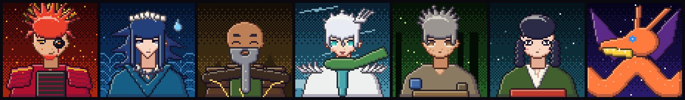
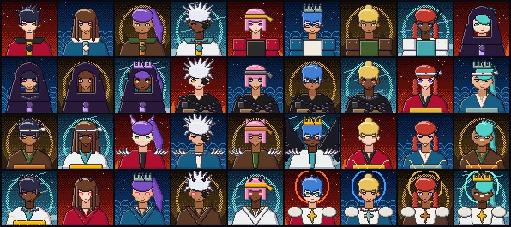

# 20 — Direção de Arte: *Sumi & Brasa* (墨と燠) em pixel art

> Bíblia visual do jogo. Dados em `data/aparencias.json`. Implementação em `src/avatar/` e `src/mapa/` (doc 21).

## 20.1 O estilo em uma frase

**Pixel art de anime com alma de biombo japonês**: personagens em busto 64×64 com olhos grandes, cabelo com
brilho em arco e contorno escuro; fundos e mapas com névoas douradas em faixas, ondas *seigaiha*, montanhas em
triângulo e degradê pontilhado — como se um biombo do período Edo tivesse sido redesenhado num console de 16 bits.

## 20.2 O que a pesquisa trouxe (referências)

| Tema | O que aprendemos | Como aplicamos |
|------|------------------|----------------|
| **Silhueta primeiro** | Um personagem deve ser reconhecível só pelo contorno; ordem de trabalho: silhueta → cor → detalhe ([RocketBrush](https://rocketbrush.com/blog/shape-language-in-game-character-design-how-to-make-characters-readable-and-consistent), [3DSense](https://3dsense.net/blogs/shape-language-in-character-design-communicating-through-geometry)) | Todo vilão tem um campo **silhueta** e uma **marca registrada** (doc 09). O motor desenha contorno escuro automático em cada peça, então a silhueta sempre aparece |
| **Linguagem de formas** | Círculos e quadrados soam confiáveis; formas anguladas e pontudas soam ameaçadoras. Um vilão redondo pode subverter a expectativa ([Fiveable](https://fiveable.me/lists/character-design-principles), [Studio Liddell](https://studioliddell.com/news/the-ultimate-guide-to-character-design-fundamentals)) | Cada reino tem uma forma (tabela 20.4). Kanata é o "vilão redondo": gentil, de óculos, sem pontas — e por isso inquietante |
| **Teste em escala de cinza** | Se o personagem só funciona com cor, a estrutura de formas está fraca ([3DSense](https://3dsense.net/blogs/shape-language-in-character-design-communicating-through-geometry)) | O sombreamento usa 4 tons por rampa: o volume aparece mesmo sem matiz |
| **Cores por elemento** | Codificar elementos por cor é convenção do gênero, mas não existe mapeamento canônico — cada obra define o seu ([TV Tropes — Color-Coded Elements](https://TVTropes.org/pmwiki/pmwiki.php/Main/ColorCodedElements), [Polycount](https://polycount.com/discussion/comment/1803424)) | Definimos nossa própria paleta por reino com **cores tradicionais japonesas** (20.3) |
| **Paletas limitadas** | Contraste complementar e poucas cores dão identidade; cores demais confundem ([Pixune](https://pixune.com/blog/character-color-palette/), [CG Wire](https://blog.cg-wire.com/character-color-palettes/)) | Máximo de 3 cores + 1 de destaque por personagem; a cor de destaque é sempre a do elemento |
| **Cores tradicionais japonesas** | Nomes como *shu* (vermelhão), *ai* (índigo), *byakugun*, *gofun*; os hex variam entre fontes ([Wikipedia — Traditional colors of Japan](https://en.wikipedia.org/wiki/Traditional_colors_of_Japan), [Gyanmirai](https://www.gyanmirai.com/tools/japanese-colors)) | Paletas dos reinos nomeadas com essas cores (hex aproximados) |
| **Yōkai de Toriyama Sekien** | O *Gazu Hyakki Yagyō* (1776) virou o modelo visual dos yōkai; os tengu dele eram aves grandes, não humanos de nariz longo ([NDL Japão](https://www.ndl.go.jp/en/imagebank/column/sekienyokai), [Wikipedia — Hyakkai Zukan](https://en.wikipedia.org/wiki/Hyakkai_Zukan)) | Kappa, Nue, Umibōzu, Tsuchigumo, Kamaitachi, Namazu e os tengu seguem a iconografia de Sekien, redesenhada no nosso estilo |
| **Mapas estilo pintura japonesa** | O ProFantasy tem um estilo de mapa que imita paisagens pintadas por cartógrafos japoneses e chineses; mapeadores de um "Edo fantástico" partiram de mapas da época e simplificaram estradas e postos ([ProFantasy Annual 2016](https://www.profantasy.com/annual/2016/february16.html), [Cartographers' Guild](https://www.cartographersguild.com/showthread.php?p=227707)) | Mapa com estradas pontilhadas entre regiões, montanhas em triângulo e ícones grandes em vez de texto |
| **Biombos dourados (byōbu)** | Folha de ouro concentrada no céu e nas bordas, tinta e pigmento *gofun* sobre papel ([1stDibs — biombos Edo](https://www.1stdibs.com/furniture/asian-art-furniture/paintings-screens/material/gold-leaf/)) | **Névoas douradas** nos cantos do mapa: a assinatura visual do mundo |

> Observação honesta: boa parte das fontes de design são blogs e guias de prática, não pesquisa acadêmica.
> Usamos como convenções de ofício, não como regras.

## 20.3 Paletas dos reinos (cores tradicionais japonesas, hex aproximados)

| Reino | Cores | Sensação |
|-------|-------|----------|
| 焔 Homura | 朱 shu `#EB6101` · 紅 kurenai `#D7003A` · 墨 sumi `#2B2B2B` · 黄金 kogane `#E6B422` | Calor, laca, guerra |
| 水 Watatsumi | 藍 ai `#165E83` · 群青 gunjō `#4C6CB3` · 水浅葱 mizu-asagi `#80ABA9` · 真珠 shinju `#F8F4E6` | Calma, profundidade, segredo |
| 土 Daichi | 鉄黒 tetsuguro `#281A14` · 金茶 kincha `#C47222` · 松葉 matsuba `#42602D` · 琥珀 kohaku `#BF783A` | Peso, tradição, raiz |
| 風 Fūjin | 白群 byakugun `#83CCD2` · 若竹 wakatake `#68BE8D` · 白練 shironeri `#F3F3F2` · 山吹 yamabuki `#F8B500` | Leveza, liberdade, movimento |
| 虚 Kokū | 胡粉 gofun `#FFFFFC` · 鈍 nibi `#727171` · 墨 sumi · 月白 geppaku `#EAF4FC` | Ausência, cor lavada |
| ☾ Eclipse | 漆黒 shikkoku `#0D0015` · 銀 gin `#C9CACA` · 蝕紫 `#5B2A86` · 燠 oki `#FF7A3D` | O mal: preto, prata, roxo e uma brasa |

**Desvio de matiz (*hue shifting*)**: em todas as rampas, a sombra puxa para roxo-azulado e a luz para amarelo-creme.
É um truque clássico de pixel art que deixa o sombreamento "vivo" em vez de só escurecer.

## 20.4 Formas por reino (linguagem de formas)

| Reino | Forma | Onde aparece |
|-------|-------|--------------|
| Homura | **Triângulos** | Cabelo espetado, ombreiras samurai, coroa-sol em raios, chamas |
| Watatsumi | **Círculos e curvas em S** | Cabelo flutuante, pérolas, golas em camadas, ondas seigaiha no fundo |
| Daichi | **Quadrados e blocos** | Ombreiras de placa, golens, rosto quadrado, montanhas |
| Fūjin | **Diagonais e penas** | Cachecóis, franja longa, asas, linhas de vento no fundo |
| Kokū | **Espaço negativo** | Rosto-buraco, partes que viram vazio, cores lavadas |
| Eclipse | **O círculo mordido** | Brasão da Guilda, anel negro no peito dos Ressurgidos, sol negro atrás do Rei do Eclipse |

## 20.5 Escala visual por tier

| Tier | Regra visual | No avatar |
|------|--------------|-----------|
| Comum | Silhueta simples, 1 cor de destaque | Sem aura |
| Médio escalão | Um acessório marcante (máscara, chapéu, arma) | Sem aura |
| Alto escalão | Figurino elaborado, assimetria forte | Sem aura |
| Nível rei | Coroa ou halo; o clima reage | **Anel de aura** pontilhado na cor do elemento |
| Divindade | Escala colossal, composição simétrica, halo | Anel de aura + coroa rachada ou halo |

## 20.6 Galerias

| Comuns (35) | Médio escalão (25) |
|:---:|:---:|
|  |  |

| Alto escalão (20) | Nível rei e divindades (20) |
|:---:|:---:|
|  |  |

| NPCs da história | Jogadores de exemplo (9 classes × 4 reinos) |
|:---:|:---:|
|  |  |

> ⚠️ As galerias incluem as versões **reveladas** de personagens com segredo (Kanata, o Rei do Eclipse...).
> Não compartilhe com jogadores — eles veem as **máscaras** até o marco de revelação (doc 14).

## 20.7 Regras de originalidade

- Nenhum personagem pode lembrar um personagem conhecido de outra obra (campo `nao_parecer` nas fichas).
  Ex.: Kanata tem cabelo **curto** com uma única trança e óculos, justamente para não lembrar vilões de cabelo branco
  longo de outras franquias.
- Yōkai do folclore (domínio público) são redesenhados no nosso estilo; nada é copiado de jogos ou animes.
