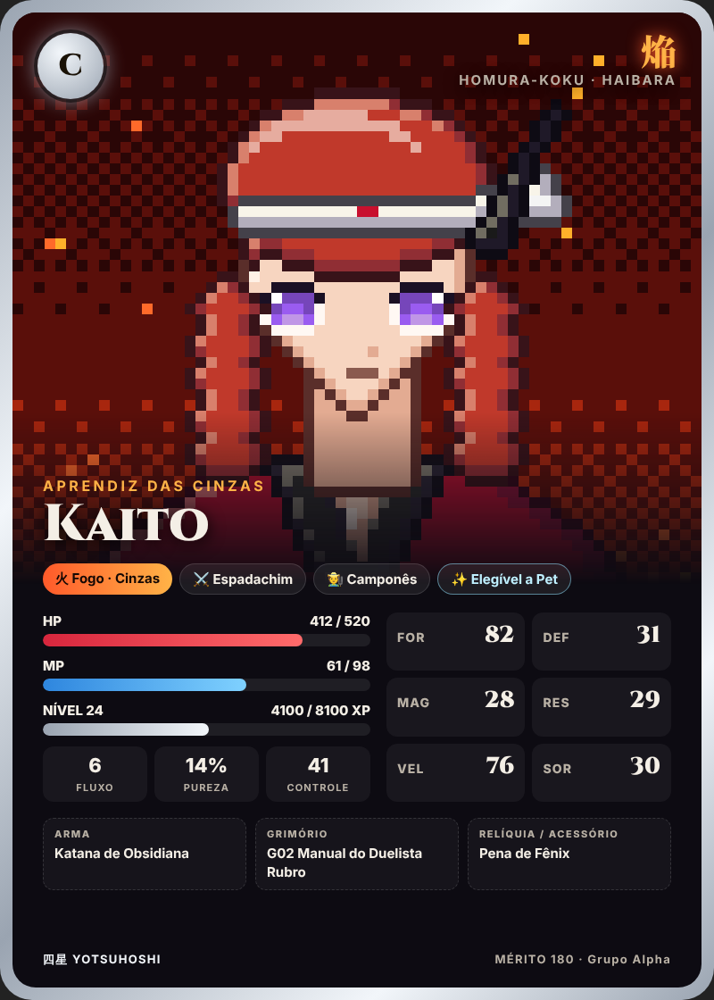
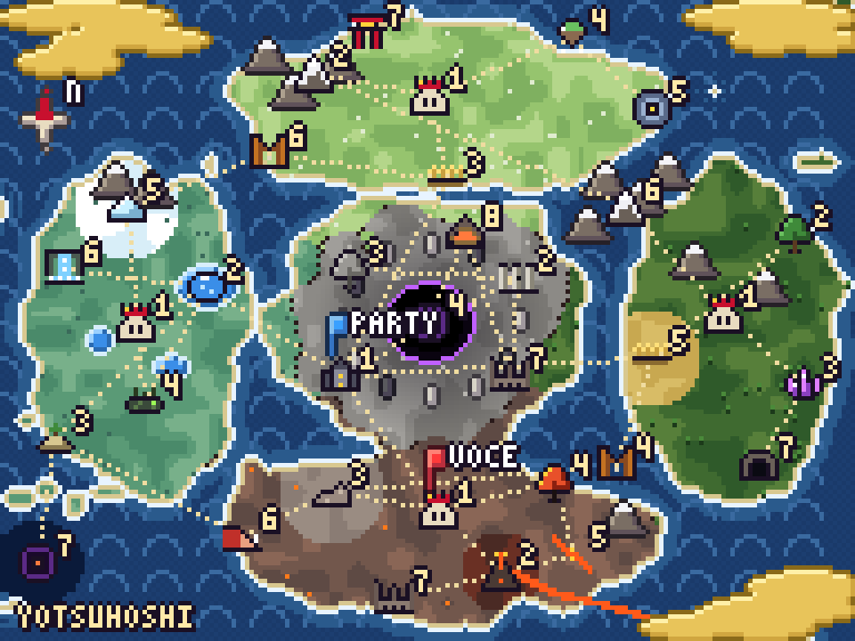

# 21 — Criador de Avatares e Mapas (pixel art procedural)

Sem IA, sem banco de imagens: **todo avatar é montado em camadas a partir de um "DNA"**, como nos criadores de
personagem de jogos 3D. O mesmo DNA gera sempre a mesma imagem. O código não tem dependências: escreve o PNG direto.

| Exemplo de carta com avatar | Exemplo de `!mapa` |
|:---:|:---:|
|  |  |

## 21.1 Como o motor desenha (`src/avatar/pixel.mjs`)

1. Cada peça (rosto, cabelo, roupa, chifre…) é uma **máscara** feita de formas simples: elipse, polígono, linha, espinho.
2. Ao carimbar a peça, o motor aplica o **acabamento de pixel art**: contorno escuro em volta, sombra na borda de
   baixo/direita e luz na borda de cima/esquerda.
3. Cada cor vira uma **rampa de 4 tons** `[contorno, sombra, base, luz]` com desvio de matiz (doc 20.3).
4. Olhos, bocas e sobrancelhas são **sprites desenhados à mão** (ASCII), espelhados para o lado direito.
5. Fundo com **degradê pontilhado** (dithering ordenado de Bayer) e padrão do tema do elemento.
6. Saída: tela 64×64 ampliada ×8 (512×512) com `image-rendering: pixelated` nas cartas.

**Ordem das camadas (humanoide):** fundo → aura → acessórios de trás (coroa-sol, asas, chifres de dragão, sombra) →
cabelo de trás → roupa → pescoço → rosto e orelhas → olhos, sobrancelhas, nariz, boca → acessórios de rosto (máscaras,
sardas) → cabelo da frente + brilho em arco → acessórios da frente (óculos, barba, coroa, cicatriz, correntes…).

## 21.2 Catálogo do criador (o que dá para escolher)

| Parte | Opções |
|-------|--------|
| Rosto | oval, fino, redondo, quadrado, largo |
| Pele | clara, média, morena, escura · *(só NPCs/vilões ou por classe/evento:)* pálida, cinza, azulada, esverdeada, vermelha, pedra, osso, espectral |
| Olhos | grande, afiado, cansado, feliz, redondo · *(especiais:)* dragão, brilho, vazio |
| Cor dos olhos | âmbar, vermelho, azul, verde-água, cinza, roxo, dourado, prata, castanho, preto, verde, rosa, branco |
| Sobrancelha | neutra, brava, triste, grossa, nenhuma |
| Boca | neutra, sorriso, sorriso torto, séria, presa, aberta, língua, triste |
| Cabelo | espetado, bagunçado, franja longa, longo, flutuante, rabo, tranças, trança lateral, careca, meio raspado, coque, chanel |
| Cor do cabelo | preto, castanho, ruivo, fogo, loiro, branco, prata, cinza, cinza-cinza, azul-escuro, azul, verde-água, verde, rosa, roxo, vinho |
| Roupa | quimono, samurai, placas, manto alto, corte, jaqueta de penas, trapos, robe de mago, sagrada, couraça de osso, nu |
| Acessórios (56) | coroas (sol, pérolas, penas, rachada), chifres (oni, pequenos, dragão), orelhas (raposa, lobo, gato), óculos, óculos de aviador, máscaras (branca, meia, tengu), bandana, hachimaki, cachecol, pena, barbas (cheia, curta, trançada), bigode, cicatriz, olho de obsidiana, tapa-olho, sardas, curativo, rubor, pintura de crescente, veias do vazio, anel do eclipse, fios de prata, colar de pérolas, gota orbitando, correntes, chapéus (juiz, corte, cartola, palha), capuz, kabuto, brasas, raízes, halo, fitas d'água, pelagem, prato de kappa, cristais, asas (penas, morcego), nariz de tengu, bandagem na boca, rosto-buraco, sombra de dragão |

**Criaturas** (`src/avatar/criaturas.mjs`) — 13 arquétipos parametrizáveis: fera, ave, serpente/dragão, peixe, anfíbio,
espírito, golem, aracnídeo, centopeia, crânio, coração, redemoinho, enxame. Parâmetros: cores, orelhas, focinho,
chifres, crina, caudas, asas, bigodes, tentáculos, translucidez, olhos (fenda, brilho, vazio) e marcas (magma, geada,
raios, correntes, brasas, anel do eclipse, terceiro olho…).

## 21.3 O avatar do jogador (ligado ao número)

Na entrada no mundo (doc 04), **depois** da Cerimônia do Sorteio:

```
🎨 Agora, o seu rosto.
O sorteio já decidiu a sua roupa, as cores do seu reino e a sua aura.
Escolha o resto (responda com os números, ex.: 2 5 1 3 7 4 1):

1) Rosto:   1 oval · 2 fino · 3 redondo · 4 quadrado · 5 largo
2) Pele:    1 clara · 2 média · 3 morena · 4 escura
3) Olhos:   1 grande · 2 afiado · 3 cansado · 4 feliz · 5 redondo
4) Cor dos olhos: 1 âmbar · 2 azul · 3 verde · 4 vermelho · 5 roxo · 6 dourado · 7 castanho
5) Cabelo:  1 espetado · 2 bagunçado · 3 franja longa · 4 longo · 5 rabo · 6 tranças · 7 chanel · 8 coque · 9 careca
6) Cor do cabelo: 1 preto · 2 castanho · 3 ruivo · 4 loiro · 5 branco · 6 azul · 7 rosa · 8 roxo · 9 verde-água
7) Marca:   1 nenhuma · 2 cicatriz · 3 sardas · 4 tapa-olho · 5 bandana · 6 óculos · 7 pena · 8 curativo
```

O bot mostra uma **prévia** (PNG) e o jogador pode refazer quantas vezes quiser **até confirmar**. Depois disso, a aparência
fica travada — como os atributos — e só muda por eventos:

| O que o sorteio/jogo decide | Efeito no avatar |
|-----------------------------|------------------|
| Reino | Cores da roupa e tema do fundo |
| Elemento | Cor da aura, padrão do fundo |
| Classe | Tipo de roupa e acessório de classe (robe + capuz do bruxo, correntes do anti-magia, halo do paladino, chifres e olhos vermelhos do demônio, orelhas do meio-humano conforme o animal sorteado…) |
| Casta | Realeza: colar de pérolas · Linhagem real: coroa rachada |
| Rank B ou maior | Anel de aura pontilhado ("Despertar") |
| Corrupção ≥ 50 | Veias do vazio aparecem (só na carta privada; a pública escurece a moldura) |
| Corrupção ≥ 75 | Anel do eclipse no peito |
| Itens lendários | Excalibur e Kokūgai entram como acessório de carta (borda dourada) |

Implementação: `dnaJogador({ id, reino, casta, classe, elemento, rank, tipoAnimal, corrupcao }, escolhas)` em
`src/avatar/dna.mjs`. O DNA fica salvo na tabela `jogadores.avatar_dna` (jsonb), ligado ao `wa_id` do número.
Comandos: `!aparencia` (durante a criação), `!avatar` (envia o avatar atual).

## 21.4 DNA dos personagens da história

- **100 vilões**: `DNA_VILOES` em `src/avatar/dna.mjs`, coerentes com a ficha visual (silhueta + marca registrada) de
  `scripts/aparencia-viloes.mjs` e com as fichas completas de `data/aparencias.json → viloes_destaque`.
- **Máscaras** (`DNA_MASCARA`): o Kanata aparece como *Yoru* encapuzado; o Rei do Eclipse aparece como o
  "Demônio do Selo" da lenda até a revelação.
- **NPCs** (`DNA_NPCS`): os 4 reis, Kaien, Sayo e Hoshiryū.

Exemplo de DNA (Rei Ryūen):

```js
{ tipo: "humanoide", reino: "Homura", elemento: "Fogo",
  rosto: "quadrado", pele: "media", olhos: "afiado", corOlhos: "ambar", sobrancelha: "brava",
  boca: "sorriso-torto", cabelo: "espetado", corCabelo: "fogo", chamasNoCabelo: true, roupa: "samurai",
  acessorios: ["coroa-sol", "barba-curta", "cicatriz", "olho-obsidiana", "brasas"] }
```

## 21.5 Mapas (`src/mapa/`)

- **Mundo** 192×144 px ampliado ×5 (960×720): `assets/mapas/mundo.png`.
- **Reinos** (recortes ampliados ×10): `assets/mapas/reino-*.png`, para `!mapa <reino>`.
- **Comando `!mapa`**: o mesmo mapa com marcadores (bandeirinha vermelha = você, azul = sua party).

Como é feito:
1. **Continente em trevo**: quatro lobos (um por reino) + o centro, deformados por ruído para a costa ficar orgânica.
2. **Biomas por reino**: estepe verde-clara (Fūjin), verde-água com lagos e geleira (Watatsumi), floresta escura,
   planície dourada e minas (Daichi), cinza e terra queimada com vulcão e rio de lava (Homura), cinza lavado
   escurecendo até a **cratera do vazio** cercada pelo **anel de pilares** (Kokū).
3. **Fronteiras** pontilhadas, irregulares (ruído).
4. **Mar** com ondas *seigaiha*, espuma na costa, arquipélago e a Fossa Shinkai escura.
5. **Ícones 9×9** desenhados à mão para cada tipo de região (castelo, vulcão, torii, cachoeira, geleira, cristal,
   cânion, pântano, ilha flutuante, olho da tempestade, pilares, ninho, abismo…) com o **número da região**.
6. **Estradas** pontilhadas entre as regiões conectadas (`data/reinos.json → conexoes`).
7. **Névoa dourada** nos cantos (biombo), rosa dos ventos e título.

### Legenda dos números

| Nº | 風 Fūjin | 水 Watatsumi | 土 Daichi | 焔 Homura | 虚 Kokū |
|:---:|---|---|---|---|---|
| 1 | Amagumo-jō | Ryūgū-jō | Iwakura-jō | Kagutsuchi-jō | Kyōkai |
| 2 | Picos Tengu | Lago Kagami | Floresta Kodama | Monte Hinokami | Muralha dos Selos |
| 3 | Estepe Susuki | Arquip. Shiranami | Minas de Shōseki | Deserto de Haijin | Floresta Petrificada |
| 4 | Ilhas Ukishima | Pântano Numa-no-Me | Cânion Ryūkotsu | Floresta Hotaru-bi | Cratera do Vazio (Torre e Trono dentro) |
| 5 | Olho da Tempestade | Geleira Hyōga | Planícies Kogane | Rio Yōgan | — |
| 6 | Desfiladeiro Kazenaki | Cachoeiras Taki-no-Koe | Cordilheira Tetsuzan | Costa Akashio | — |
| 7 | Templo Raijin | Fossa Shinkai | Cavernas Yomi-no-Ana | Ruínas de Enma | Ruínas de Hinata *(Ato III)* |
| 8 | — | — | — | — | Monte Ryūsō *(Ato III)* |

## 21.6 Comandos para regenerar

```bash
node scripts/render-avatares.mjs   # 100 vilões + máscaras, NPCs, 36 jogadores de exemplo, galerias
node scripts/render-mapas.mjs      # mapa do mundo, 5 reinos, exemplo do !mapa
node scripts/render-cartas.mjs     # cartas de exemplo com os avatares
```
