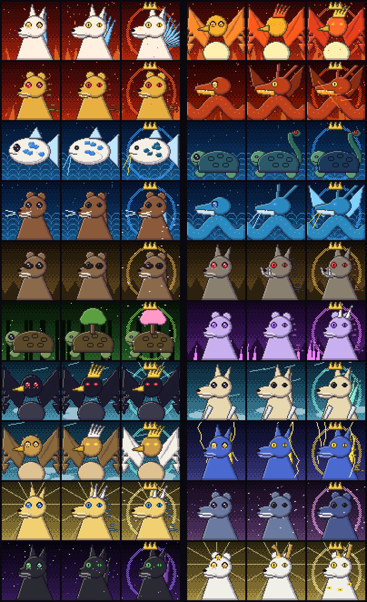

# 23 — Pets Espirituais (arte e jogabilidade)

*Cada linha mostra 2 pets nos 3 estágios: **Filhote → Desperto → Ascendido**. Sprites em
`assets/avatares/pets/<ID>-<estágio>.png`, gerados por `node scripts/render-pets.mjs` (DNA em `src/avatar/dna.mjs → PET`).*

## 23.1 Como se ganha um pet

1. Só quem é **elegível** (sorteio de entrada, doc 04.5) recebe o **Sinal do Espírito**.
2. O sinal aponta um **Santuário** do elemento do jogador (Fogo: SF-HOM-05 · Água: SF-WAT-06 · Terra: Floresta Kodama / SF-DAI-03 · Vento: SF-FUJ-03).
3. **Provação do Santuário**: o guardião testa o jogador em 3 desafios. Um é de combate e dois são narrativos, julgados pelo Juiz de Táticas: coragem, gentileza, astúcia.
4. O pet é sorteado entre os do elemento do jogador, com peso pela nota da provação. Pets **raros** (Kirin, Baku, Nekomata, Hakutaku) exigem as restrições de `data/pets.json`.
5. **O jogador dá o nome ao pet**, com as mesmas regras do nome de personagem (2–14 letras, sem nomes de NPCs). O nome da espécie aparece embaixo, na carta do pet.

## 23.2 O pet em combate

O pet **não ocupa o turno do jogador**. Ele age sozinho no fim de cada rodada:

| Papel do pet | Ação automática |
|--------------|-----------------|
| Dano / dano em área | Ataca o alvo do dono (ou todos, a cada 3 rodadas) |
| Tanque | Recebe parte do dano do dono |
| Cura / suporte | Cura ou limpa estados do dono quando ele está abaixo de 50% |
| Controle | Prende ou atordoa um inimigo a cada 4 rodadas |
| Utilidade / batedor | Fora de combate: revela segredos, acha itens extras |

- **Ordem especial** (`pet` como ação de batalha, 1× por luta): a habilidade do pet (doc `data/pets.json → habilidade`) com efeito dobrado.
- **Elemento do pet conta nas reações elementais** (22.8): pet de Água + magia de Fogo do dono = 🌀 Vapor.
- Se o pet chega a 0 de energia, ele **desmaia** (volta após 1 h real ou ao descansar). **Pets nunca morrem.**

## 23.3 Vínculo e evolução

**Vínculo (絆, 0–100)**:

| Como sobe | Quanto |
|-----------|:---:|
| Vencer batalha com o pet ativo | +1 |
| `!pet carinho` (1× por dia) | +2 |
| Alimentar com comida da região natal do pet | +3 |
| O pet salvar o dono (cura ou bloqueio que evitou uma queda) | +5 |
| O dono cair em batalha | −2 |
| O dono atingir Corrupção ≥ 50 | O vínculo trava (o pet sente o vazio) |

| Estágio | Requisito | O que muda |
|---------|-----------|------------|
| 🥚 **Filhote** | Ao obter | Olhos grandes; a habilidade age com 50% da força |
| 🌱 **Desperto** | 20 vitórias juntos + Vínculo 50 | Traços completos (chifres, crina, asas, mais caudas); habilidade com 100% |
| 🌟 **Ascendido** | 60 vitórias + Vínculo 100 + um marco de história do arco do reino do pet | Aura e coroa espiritual; habilidade ×1,5 e uma **segunda habilidade** do elemento |

A evolução é anunciada no grupo com a carta do pet antes e depois. Ela também é uma das fontes de crescimento de atributos (doc 22.9): o pet Ascendido dá **+3%** nos atributos fortes do elemento dele.

## 23.4 Os 20 pets

| ID | Pet | Elemento | Papel | Traço do Desperto | Traço do Ascendido |
|----|-----|----------|-------|-------------------|--------------------|
| P01 | Kitsune-bi | Fogo | Dano mágico | 3 caudas de fogo-fátuo | 9 caudas |
| P02 | Hiyoko (fênix) | Fogo | Suporte | Crista de chamas | Plumagem rubra e coroa |
| P03 | Shishi de Brasa | Fogo | Tanque | Juba cheia e presas | Juba em brasa |
| P04 | Ryū-chan | Lava | Dano em área | Asas | Veias de magma |
| P05 | Koi Celeste | Água | Cura | Barbilhões | Barbilhões dourados |
| P06 | Genbu-mirim | Água | Tanque | Cauda-serpente | Casco abissal |
| P07 | Kawauso | Água | Utilidade | Cauda | Cauda de água e estrelas |
| P08 | Mizuchi-mirim | Água | Controle | Barbilhões | Asas de água |
| P09 | Ponpoko (tanuki) | Terra | Ilusão | Cauda listrada | Brilho estelar |
| P10 | Inoshishi de Pedra | Terra | Dano físico | Presas e crina | Crina de ouro-chá |
| P11 | Kodama-game | Madeira | Cura de MP | Árvore no casco | Árvore em flor |
| P12 | Komainu de Cristal | Cristal | Anti-magia | Juba de cristal | Chifre de cristal |
| P13 | Yatagarasu-mirim | Vento | Batedor | Crista dourada | Fundo de luz solar |
| P14 | Kamaitachi-mirim | Vento | Dano rápido | Cauda | 3 caudas de vento |
| P15 | Grifo-filhote | Vento | Montaria | Crista | Asas brancas |
| P16 | Raijū | Raio | Dano | Raios no corpo | Crina elétrica e 2 caudas |
| P17 | Kirin ✦ | Luz | Sagrado | Chifre e crina | Brilho estelar |
| P18 | Baku ✦ | Sonho | Controle | Constelações | Pelagem noturna |
| P19 | Nekomata ✦ | Trevas | Necromancia | 2 caudas e chamas roxas | Caudas roxas |
| P20 | Hakutaku ✦ | Luz (Sabedoria) | Conhecimento | Chifres | Olhos pelo corpo |

✦ = raro (restrições em `data/pets.json`).

## 23.5 Comandos

| Comando | Efeito |
|---------|--------|
| `!pet` | Carta do pet: sprite, nome, estágio, vínculo, habilidade |
| `!pet nome <nome>` | Só ao receber o pet |
| `!pet carinho` | +2 de vínculo (1× por dia), com uma reação fofa gerada pela IA |
| `!pet alimentar <item>` | +3 de vínculo com a comida da região natal do pet |
| `pet` (em batalha) | Ordem especial (1× por luta) |
