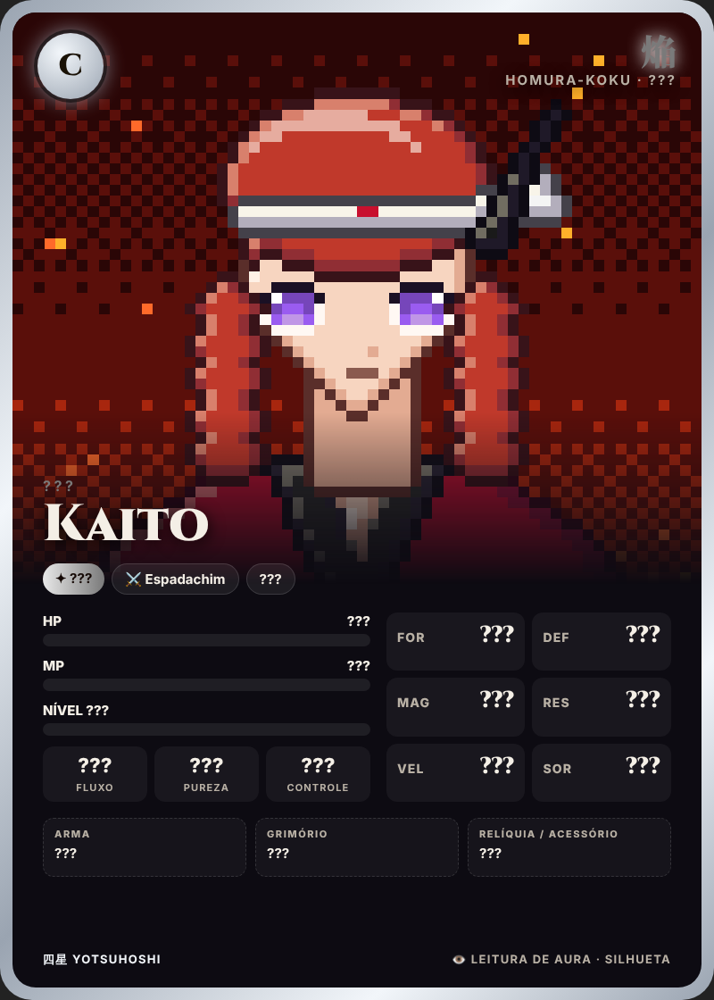
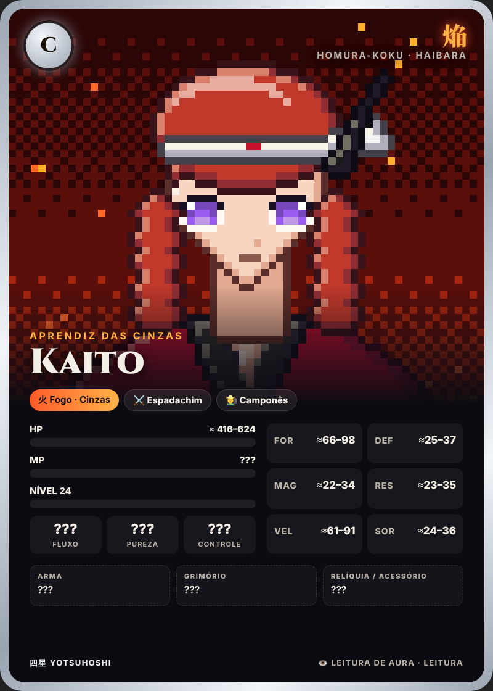
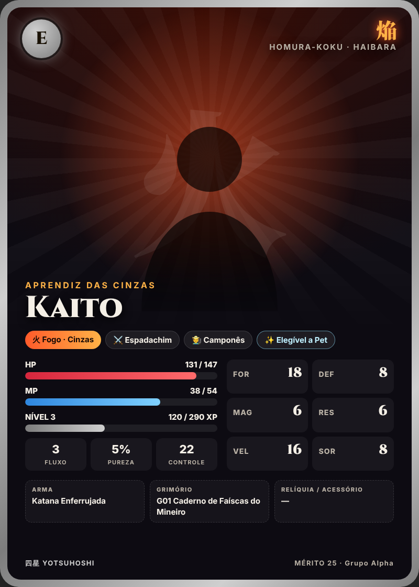

# 29 — Travas, Técnicas Universais e Casos Especiais

> Implementado: travas de linguagem em `src/linguagem/` (91 testes) e o Olho Avaliador em `src/regras/avaliar.mjs`
> (12 testes, `node scripts/testar-regras.mjs`).

---

## 29.1 Travas: ninguém ganha poder pedindo

A IA **não concede nada**. Todo efeito mecânico vem do motor, e o motor só aceita fontes registradas (doc 22.9).

| O jogador tenta | Exemplo | O que acontece |
|-----------------|---------|----------------|
| Pedir atributo | "me dá 1000 de força" | `pedido_atributo` → resposta fixa in-character, sem IA |
| **Pedir buff de habilidade** | "deixa minha magia mais forte", "faz meu golpe dar o dobro", "buffa minha katana", "considera que minha habilidade não tem recarga", "upa meu pet" | `pedido_buff` → *"As técnicas crescem com o uso e com o sangue derramado, não com súplicas."* |
| **Alegar poder numa ação livre** | `> uso o iaijutsu que causa 1000% de dano e mata na hora` | A ação **acontece**, mas o motor **ignora as alegações** (`alegacoes_de_poder: ["1000 %", "mata na hora"]`): o dano é calculado pela fórmula normal e o Juiz de Táticas dá **coerência 0** à parte inventada |
| Inventar habilidade | `> ganho uma nova técnica de fogo negro` | Alegação ignorada; a IA narra a tentativa falhando |
| Ignorar regras | `> giro a espada e ignoro toda defesa dele` | Golpe normal; "ignorar defesa" não existe sem fonte (Excalibur, Lâmina Branca…) |
| Pedir a outro jogador para "pedir por ele" | — | Mesma trava (quem pede não importa) |
| Mudar a ficha pela conversa | "minha ficha na verdade é nível 50" | A ficha vem **só do banco**; a IA nunca lê números do texto do jogador |

**Escalada:** 3 tentativas no mesmo dia → aviso privado; 6 → ação livre bloqueada por 30 min; reincidência semanal →
registro para o admin. Nada disso tira XP ou itens (não é punição de jogo, é proteção).

**Por que a IA não "cede":** ela não tem nenhuma ferramenta que altere atributos, habilidades ou dano. O máximo que
pode fazer é **propor** um multiplicador ao Juiz de Táticas, que o motor limita a 0,6–1,8 e zera quando há alegação.

---

## 29.2 Técnicas Universais (habilidades específicas que qualquer classe aprende)

Aprendidas no **Dōjō** de qualquer capital (ou com mestres em contos). Cada uma tem **requisito de atributo** e
**custo de energia** (Vigor fora de combate; MP — ou Vazio para o anti-magia — em combate).

| Técnica | Requisito | Custo | Efeito | Onde aprender |
|---------|-----------|-------|--------|---------------|
| 👁️ **Olho Avaliador** (霊視) | Nível 5 · MAG + SOR ≥ 20 (anti-magia: usa RES) | 15 Vigor + 10 MP (anti-magia: 20 Vazio) | **Ver o card de outro jogador** (29.3) | Dōjō, 300 ryō |
| 🌫️ **Ocultar Aura** | Nível 8 · RES ≥ 15 | 10 Vigor | +30 de defesa contra leitura por 1 h; esconde você de "Sentir Presença" | Dōjō, 400 ryō |
| 📡 **Sentir Presença** | Nível 10 · VEL + SOR ≥ 30 | 10 Vigor | Lista jogadores e vilões de nível rei+ na sua região (sem nomes, só "uma presença forte ao norte") | Picos Tengu |
| 🏃 **Passo Rápido** | VEL ≥ 25 | 8 MP | Fuga com +25% de chance; 1× por batalha | Estepe Susuki (nômades) |
| ⚓ **Âncora** | MAG ou RES ≥ 30 | 12 MP | Impede **teletransporte** de um alvo por 3 rodadas (29.6) | Biblioteca Submersa |
| 🐾 **Rastrear** | Nível 12 · VEL ≥ 20 | 10 Vigor | Segue o rastro de um jogador/NPC/vilão que passou pela região nas últimas 24 h | Cordilheira Tetsuzan |
| 🩹 **Primeiros Socorros** | DEF ≥ 15 | 10 Vigor | Fora de combate: cura 20% de um aliado (1×/h); remove "Ferido" leve | Templo |
| 🧘 **Meditação** | MAG ≥ 20 | — (custa 30 min reais parado) | Recupera 50% do MP sem estalagem | Mosteiro Tengu |
| 📜 **Leitura de Runas** | MAG ≥ 25 ou marca *Erudito* | — | Lê inscrições antigas (pistas, enigmas) sem teste | Ryūgū-jō |
| 🥷 **Passos Silenciosos** | VEL ≥ 30 | 10 Vigor | Exploração furtiva: emboscadas a seu favor por 1 h | Kyōkai (mercado negro) |

- Cada jogador pode ter no máximo **4 técnicas universais** ativas (troca no Dōjō, 100 ryō).
- Técnicas sobem de grau com uso (Maestria): grau II após 30 usos (custo −30%), grau III após 100 (efeito +50%).

---

## 29.3 Ver o card de outro jogador (`!avaliar @x` ou "quero ver o nível da @Aya")

```
Leitura = MAG/2 + SOR + 2×nível (+8 Mago/Bruxo/Paladino, +15 pet Hakutaku, +5 Erudito)   [anti-magia: RES/2 + SOR]
Defesa  = RES/2 + VEL/2 + 2×nível (+30 Ocultar Aura, +15 marca Sombra, +25 Kokūgai)
Margem  = Leitura − Defesa + (d20 − 10)
```

| Margem | Nível da leitura | O card mostra |
|:---:|------------------|---------------|
| < −10 | 0 · **Aura turva** | Só o nome. O alvo **percebe e descobre quem tentou** |
| −10 a 0 | 1 · **Silhueta** | Rank, reino, classe |
| 1 a 15 | 2 · **Contorno** | + nível exato, elemento, aldeia, HP aproximado |
| 16 a 30 | 3 · **Leitura** | + título, casta, pet, **atributos em faixas** (±20%) |
| > 30 | 4 · **Visão completa** | Todos os números, MP, equipamento, Mérito |

- **Nunca revela:** Corrupção, pactos, portador do Ovo, Chaves de Conhecimento, facção Arautos, Amuleto.
- Se a margem for menor que 15, o alvo recebe no privado: *"Você sente um olhar atravessando sua aura."*
- O resultado chega **no privado** como uma carta com "???" (exemplos em `templates/exemplos/personagem-avaliado-*.png`).
- Recarga: o mesmo alvo só a cada 6 h. Também funciona em NPCs e vilões (contra vilões a defesa usa os atributos deles).

| Silhueta | Leitura | Card real |
|:---:|:---:|:---:|
|  |  |  |

---

## 29.4 Luta real entre jogadores e o Veredito

O **duelo** comum (doc 22.8) continua amistoso: termina em 1 HP. A **luta real** é diferente: quando chega ao fim,
**o vencedor decide o destino do derrotado**.

### Quando existe luta real
| Situação | Consentimento |
|----------|---------------|
| `!luta-real @x` aceito pelos dois (com aviso ⚠️ e confirmação 👍 dupla) | Explícito |
| **Terras sem Lei** (Floresta Petrificada e arredores da Cratera) — `!emboscar` | Ao entrar na região |
| Contra um **Arauto Jogador** (Corrupção 100, doc 16) ou um condenado por traição em julgamento | Pela história |
| Traição prevista por pacto (`!trair`) | Pela história |

Proteções: nunca contra jogadores abaixo do nível 10; nunca com diferença acima de 15 níveis (exceto Arauto);
no máximo 2 contra 1; nenhuma luta real durante crises de mundo ou escoltas.

### O Veredito
Quando o HP do derrotado chega a 0, a luta para e o vencedor recebe, **no privado**, 60 s para decidir. Enquanto isso,
o derrotado pode mandar suas **últimas palavras** (a IA as narra no veredito).

```
⚖️ VEREDITO — Rin está de joelhos, a lâmina dela partida.
1) 🗡️ FINALIZAR
2) 🕊️ DEIXAR IR
3) ⛓️ EXIGIR RENDIÇÃO (tomar 1 item comum ou 10% do ryō)
⏱️ 60 s (sem resposta = deixar ir)
```

| Escolha | Para o derrotado | Para o vencedor |
|---------|------------------|-----------------|
| 🗡️ **Finalizar** | Em luta real **consentida**: **Morte Verdadeira** (Carta Memorial, reencarnação — doc 19.3). Em Terras sem Lei: +1 Marca da Morte, perde 1 item não equipado, e morte verdadeira só se já tinha 3 Marcas | Estado **"Sangue nas Mãos"** por 7 dias (NPCs desconfiam, preços +20%, a Excalibur pesa); conta para *Implacável*; −40 Mérito (exceto contra Arauto/condenado); os aliados da vítima podem pôr uma **Recompensa** pela sua cabeça; Kanata envia um sussurro de "parabéns" |
| 🕊️ **Deixar ir** | Volta à última capital com 1 HP e o status **"Dívida de Vida"** com o vencedor | +20 Mérito, conta para *Misericordioso*. A Dívida de Vida faz o derrotado **não poder iniciar luta contra você** até pagá-la (salvando você em batalha, ou com um favor registrado) |
| ⛓️ **Exigir rendição** | Entrega 1 item comum ou 10% do ryō; volta à capital com 1 HP | Sem Mérito nem perda; conta como vitória |

- A escolha é anunciada no grupo com uma cena curta da IA (a decisão vira história).
- **Itens lendários, o Ovo e núcleos nunca são tomados** numa luta real, nem por "finalizar". Se o portador do Ovo
  morrer, o Ovo **escolhe um novo portador** (doc 14.6).
- Fugir por teletransporte (29.6) encerra a luta **sem** veredito.

---

## 29.5 Quando os jogadores tentam algo cedo demais: a Interferência do Destino

O mundo é aberto, mas a história tem ordem. Quando alguém tenta pular etapas, o jogo **interfere de forma
narrativa e coerente** — nunca com "você não pode fazer isso".

| Nível | Quando | Como aparece |
|-------|--------|--------------|
| 🌫️ **Sussurro** | Ir a lugares de atos futuros, perguntar sobre camadas de verdade ainda fechadas | Sonhos, NPCs que mudam de assunto, um animal que bloqueia a trilha, névoa |
| 🧱 **Barreira** | Entrar em regiões ou subfases trancadas por marco | Barreira física da história: tempestade do Olho, selo da Muralha, maré da Fossa, "a ponte não está lá" |
| ☠️ **Aviso mortal** | Enfrentar algo muito acima do nível (sem trava de história) | É permitido, mas é uma **Batalha Mortal** anunciada com telegrafias fortes (o Corvo de Enma pousa no seu ombro) |
| 🛡️ **Destino Selado** | Matar um personagem essencial antes da hora | Ele **sobrevive de forma justificada** e paga um preço (ver abaixo) |

### O que fica trancado até quando

| Conteúdo | Libera em | Interferência antes disso |
|----------|-----------|---------------------------|
| Ruínas de Hinata e Monte Ryūsō | A3-M1 | 🧱 Uma névoa sem cor que devolve o jogador à borda (a cada tentativa, a névoa "fala" uma frase do prólogo) |
| Torre Sem Fim | A4-M1 (ou K11 após A3) | 🧱 A porta só existe para quem carrega 2+ núcleos ou o Ovo desperto |
| Subfases lendárias | Ato III (exceto as dos arcos de reino) | 🧱 O guardião não acorda; os portões não abrem |
| Atacar um rei atual | Fora do arco do reino | 🛡️ A guarda real intervém; Batalha Mortal contra 3 guardas de elite + perda de reputação no reino |
| Confrontar Kanata | Antes de A2-M3 | 🌫️ "Yoru" nunca está onde dizem; após A2-M3 ele pode lutar |
| Usar o Ovo / Esquife | Antes de A3-M8 / A4 | 🌫️ O ovo esfria e pesa; o Esquife não responde |
| Saber camadas de verdade | Antes do marco | 🌫️ A IA só dá pistas (doc 14.7) |
| Usar Chaves de Conhecimento | Sem ter vivido o conto/flashback | O motor checa a **posse** da chave: digitar a resposta certa sem a chave não funciona ("as palavras não têm peso na sua boca") |

### Destino Selado (personagens que não podem morrer cedo)
Kanata (até A4-M6), os quatro reis atuais (fora dos seus arcos), Kaien, Nisteroy, Tōya (até A4-M5).
Se o HP deles chegar a 0 antes da hora:
- **Escapam de forma narrativa** (os fios de Kanata o puxam; o rei é arrastado pelos guardas; o eco se desfaz);
- **Pagam um preço real**: começam o próximo encontro com −20% HP, perdem um servo, ou o Relógio do Eclipse cai 3%;
- Os jogadores recebem **a recompensa completa** da luta e um feito especial ("Feriu o Profeta antes da hora").

> Isso evita quebrar a história **sem tirar o mérito** de quem foi forte o bastante.

### Quebra de sequência aceita
Se os jogadores acharem um caminho legítimo antes do previsto (uma chave, um conto, uma ideia muito criativa que o
Juiz aprovar), o jogo **aceita** e adapta: o marco seguinte é antecipado, mas as camadas de verdade continuam no lugar
(a cena muda, os segredos não).

---

## 29.6 Teletransporte e fuga

### Fontes de teletransporte
| Fonte | Quem | Alcance | Custo / recarga |
|-------|------|---------|-----------------|
| **Pergaminho de Fuga** | Qualquer um (loja, 250 ryō) | Sai de batalha comum para a região anterior | Consumível; **não funciona em chefes nem em Batalhas Mortais** |
| **Pedra de Retorno** | Qualquer um (raro) | Teleporta para a última capital, **fora de combate** | Consumível |
| **Tenmon no Tama** | Portador | Qualquer região visitada; dentro de combate, "Dobra" | 1 h real (fora) · 1×/batalha (Dobra) |
| **Passo do Céu** | Jogador da Linhagem Real de Fūjin com Mana Única de vento | 2 pontos que consegue ver | 1×/batalha |
| **Amuleto da Perdição** | Se o desejo for teletransporte | Definido no desejo (com Perdição) | Pela habilidade concedida |
| **Grimório do Tempo/Espaço** | Magos | Curto (troca de fileira/distância) | MP |

### Regras
1. **Canalização:** todo teletransporte em combate leva **1 rodada**. Se o jogador sofrer dano maior que 15% do HP
   máximo nessa rodada, a canalização **quebra** (o item não é gasto).
2. **Âncora** (técnica 29.2), **Correntes** do anti-magia, **Selar** (G33) e **Corrente Zero** (G32) bloqueiam teletransporte.
3. **Kokū (densidade 0):** nenhum teletransporte funciona (o Vazio "come" os portais).
4. **Batalhas de história** (Mortais, chefes de arco, Ato IV): selam a área; só a Tenmon funciona, e com 50% de chance.
5. **Rastro:** cada teletransporte deixa rastro por 1 h (Rastrear vê o destino; criaturas do vazio também).
6. **PvP:** fugir por teletransporte de uma luta real a encerra **sem Veredito** e sem perdas, mas o fugitivo
   ganha "Fuga Covarde" por 24 h (−10% em tudo) se tiver sido ele quem iniciou a luta.
7. **Party:** a Tenmon leva até 5 aliados; o Pergaminho de Fuga, só quem o usa.

### Teletransporte dos vilões
Kanata (fios de contrato), o Arquivista (Dobra Espacial), Yoru/Leiloeiro (portas da Guilda) também fogem por
teletransporte, e **as mesmas travas valem contra eles**: uma Âncora bem colocada impede a fuga de Kanata no Ato III.
Isso é uma das formas de "prender" um vilão antes da hora — com o Destino Selado ainda valendo para a morte.

---

## 29.7 Habilidades específicas: como interagem (casos difíceis)

**Ordem de prioridade** quando efeitos se chocam:
```
Anulação (Vazio) > Selo > Teletransporte > Imunidade > Controle (prender, congelar, petrificar) > Buff/Debuff > Dano
```

| Caso | Resolução |
|------|-----------|
| Olho Avaliador × Ocultar Aura | Fórmula 29.3 (+30 na defesa) |
| Teletransporte × Âncora | Âncora vence (prioridade Selo > Teletransporte) |
| Anti-magia × qualquer magia de leitura/controle | O anti-magia é imune a efeitos mentais; leitura usa a defesa normal +10 |
| Kanata copia uma técnica universal | Pode copiar (24 h); técnicas universais copiadas funcionam com 50% de efeito |
| Shokuō rouba uma habilidade | Só habilidades de classe e magias; técnicas universais e ações livres não são roubáveis (base da K09) |
| Amuleto com controle mental em jogadores | Só temporário (máx. 1 rodada), nunca fora de combate (Lista Proibida) |
| Ressuscitar alguém que sofreu Morte Verdadeira | Impossível. Ressurreições só funcionam **dentro da mesma batalha** (Caído) |
| Invisibilidade/furtividade × Sentir Presença | Sentir Presença detecta, mas não identifica; Passos Silenciosos + Ocultar Aura juntos escondem |
| Tempo (Voltar um Turno, G39) em PvP | Proibido em luta real e duelo (para não reverter um Veredito) |
| Petrificação × Kokūgai | Kokūgai é imune |
| Duas Mana Únicas iguais | Impossível: Mana Única é registrada no mundo (doc 03) |
| Pet × luta real | Pets lutam; mas não podem dar o golpe final (o Veredito é sempre do jogador) |
| Habilidade do Amuleto em Batalha Mortal de história | Funciona, exceto se for teletransporte (regra 29.6.4) |
