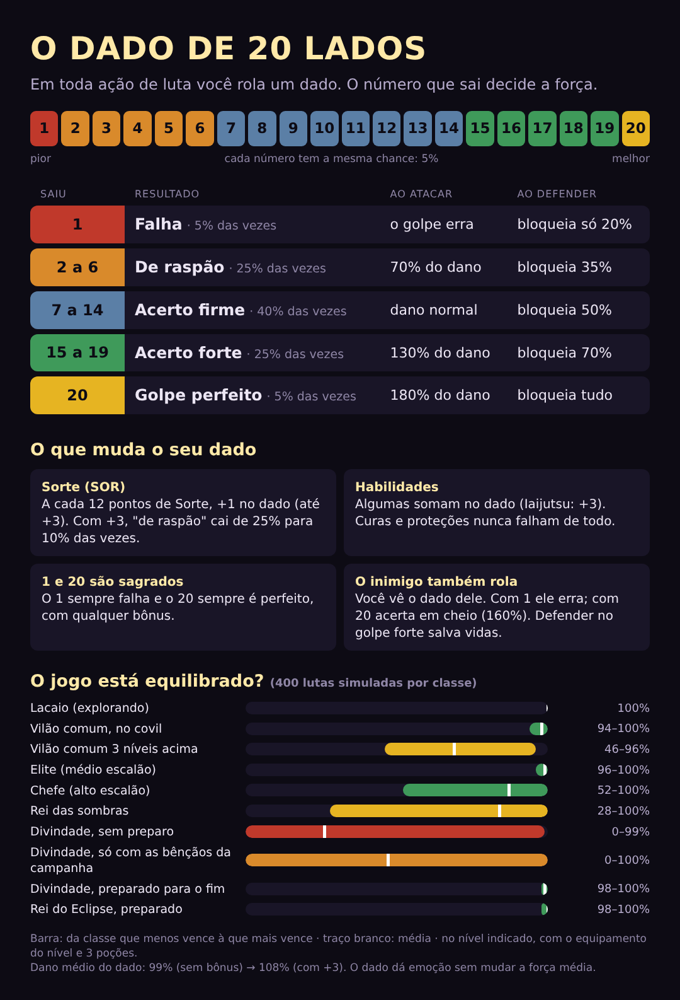

# 35 — O dado (d20) e o equilíbrio do jogo



No jogo, o comando **`dado`** (no privado ou no grupo) envia esta imagem.

## 35.1 Como o dado funciona

Toda ação de luta rola **um dado de 20 lados**. O número aparece na mensagem (`🎲 *14* — acerto firme`).

| Saiu | Resultado | Chance | Ao atacar | Ao defender |
|:---:|-----------|:---:|-----------|-------------|
| 1 | Falha | 5% | o golpe erra | bloqueia só 20% |
| 2–6 | De raspão | 25% | 70% do dano | bloqueia 35% |
| 7–14 | Acerto firme | 40% | dano normal | bloqueia 50% |
| 15–19 | Acerto forte | 25% | 130% do dano | bloqueia 70% |
| 20 | Golpe perfeito | 5% | 180% do dano | bloqueia tudo (e abala a guarda de elites) |

**O que soma no dado**

| Fonte | Bônus |
|-------|-------|
| Sorte (SOR) | +1 a cada 12 pontos, até +3 |
| Habilidade *Iaijutsu* (Espadachim) | +3 naquele golpe |
| Olhos da Terra, ao defender | +2 |
| Olhos da Terra contra espíritos e deuses (não tocam o chão) | −2 ao atacar, sem bônus ao defender |

- O **1** sempre falha e o **20** sempre é perfeito, com qualquer bônus. O bônus só empurra os resultados do meio para cima.
- **Curas e proteções** nunca falham de todo: com 1, valem metade; com 20, valem 30% a mais.
- **O inimigo rola o dele à vista**: 1 erra · 2–6 = 70% · 7–14 = 100% · 15–19 = 125% · 20 = 160%. Inimigos mais rápidos que você ganham até +3 no dado; mais lentos, até −3.
- **Fugir** também é um dado: precisa de 9 ou mais (a Velocidade soma ou tira até 6). Chefes não deixam fugir.

**O dado muda a força média?** Não. Sem bônus, o dano médio é 99% do dano-base; com +3 de Sorte, 108%. O dado cria emoção e viradas, sem deixar o resultado na mão da sorte.

## 35.2 Equilíbrio: o que as simulações mostram

Tabela completa (9 classes × 10 situações, 400 lutas por célula) em **[35b](35b-tabela-equilibrio.md)**, gerada por `node scripts/simular-combate.mjs`.

| Situação | O que esperar |
|----------|---------------|
| Lacaios (explorando) | 100% no nível certo: é o treino do dia a dia, em 3 a 4 rodadas |
| Vilão comum no covil | 94–100%: a primeira prova de cada região |
| Vilão comum 3 níveis acima | 46–96%: dá para arriscar, mas dói. Classes de armadura pesada aguentam melhor |
| Elite (médio escalão) | 96–100% no nível do vilão; abaixo do nível, cai rápido |
| Chefe (alto escalão) | 52–100%: Mago, Espadachim e Demônio precisam jogar bem (proteger-se no golpe forte) |
| Rei das sombras | 28–100%: é para chegar preparado |
| Divindade, sem preparo | Quase impossível para 7 das 9 classes. É o esperado |
| Divindade, só com as bênçãos da campanha | 0–100%: as classes frágeis ainda precisam de mais |
| Divindade e Rei do Eclipse, preparado | 98–100% com os Grandes Itens, o pet evoluído e o apoio do grupo |

**Leitura:** o fim do jogo não se vence por nível, e sim por **preparo**: concluir os arcos dos reinos (+5% cada), conquistar os Grandes Itens,
evoluir o pet e pedir o apoio do grupo (+10% por apoio). É o que faz a campanha inteira valer para a luta final.

## 35.3 Pontos de atenção (para ajustar com jogadores reais)

1. **Classes frágeis no fim:** Mago, Bruxo, Espadachim e Demônio dependem demais de itens lendários contra divindades. Opções: dar a cada uma
   uma segunda proteção no nível 25, ou reduzir o ataque das divindades em 10%.
2. **Preparado fica fácil demais (98–100%):** com tudo em mãos, a luta final perde tensão. Opção: o Rei do Eclipse ganhar uma segunda fase que ignore parte dos bônus.
3. **Vilão 3 níveis acima** varia muito entre classes (46% a 96%). Aceitável, mas vale observar se quem escolhe Meio-humano e Força da Natureza desiste cedo.
4. As simulações usam um jogador "razoável". Jogadores reais erram mais no começo e acertam mais depois.

## 35.4 Como refazer

```bash
node scripts/simular-combate.mjs
```

```bash
node scripts/render-guia-dado.mjs
```
